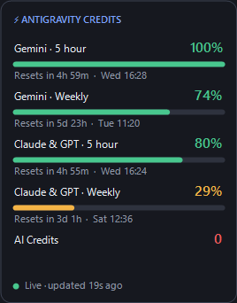

# Antigravity Credit Overlay

A small always-on-top Windows window that shows your Google Antigravity quota and AI credits in real time.



It shows Gemini and Claude/GPT 5-hour and weekly limits, your AI Credits balance, reset countdowns, and when the data was last updated.

## Requirements
- Windows 10 or 11 (uses the built-in .NET Framework 4.x, so there is nothing to install)
- The [Antigravity CLI](https://antigravity.google/docs/cli) (`agy`), installed and signed in once

## Install
1. Download `AgyCreditOverlay.exe` (or the zip) from the [Releases](../../releases) page.
2. Double-click it. The overlay appears at the top-right of your screen, with a tray icon.
3. Right-click the overlay or the tray icon and tick **Start with Windows** if you want it every time.

## How it works
Every 60 seconds the app runs `agy -p /usage` and `agy -p /credits` in the background. No window opens and no model is called, so it doesn't use your credits.
It works whether or not a CLI window is open. It only polls while the overlay is visible.

> Windows SmartScreen may warn about an unsigned app the first time. Choose **More info → Run anyway**, or build it yourself with `build.ps1`.

## Use
- Left-drag to move the overlay. Double-click it to open the CLI.
- Right-click it, or the tray icon, for: Hide/Show, Only show while Antigravity is open, Lock position, Opacity, Start with Windows, Exit.
- Left-click the tray icon to show or hide the overlay.

## Build from source
```powershell
powershell -ExecutionPolicy Bypass -File build.ps1
```
This uses the C# compiler that ships with Windows and creates `bin\AgyCreditOverlay.exe`.

## Optional: live updates from an open CLI session
`install.ps1` also hooks `bin\agy-statusline.exe` into the CLI `statusLine` setting. That makes the overlay update instantly while a CLI session is open. It is not required. `uninstall.ps1` removes it.

This is an unofficial community tool and isn't affiliated with Google.
